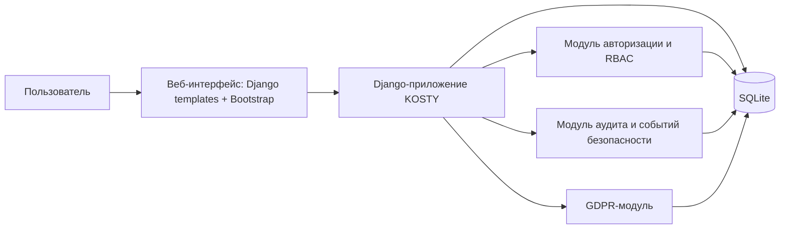

# Архитектура

KOSTY построен как монолитное Django-приложение с несколькими доменными apps:

- `accounts` — профили, роли, регистрация, вход, MFA и RBAC;
- `clients` — учет клиентов и согласий;
- `tickets` — клиентские заявки;
- `security` — события безопасности и устройства;
- `gdpr` — экспорт данных, запросы на удаление, политика хранения.

## Поток запроса

1. Пользователь открывает защищенную страницу.
2. Django проверяет сессию.
3. RBAC-декоратор проверяет активность профиля, роль и флаг подозрительной сессии.
4. При отказе создается `SecurityEvent`.
5. При успешном доступе view работает с данными через Django ORM.

## Почему такая архитектура

Для курсовой работы выбран простой монолит: он легко запускается, читается и демонстрирует архитектурные принципы без чрезмерной корпоративной сложности.
